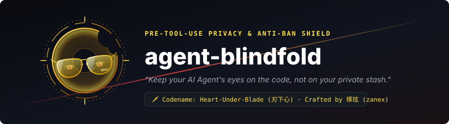
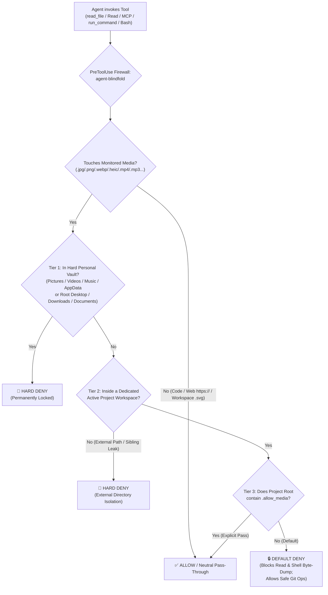

<div align="center">



# 🕶️ agent-blindfold

### *"Keep your AI Agent's eyes on the code, not on your private stash."*

**Codename: `Heart-Under-Blade` (`刃下心`)**

[](https://github.com/zanex/agent-blindfold/actions/workflows/ci.yml)
[](./LICENSE)
[](#quick-start--one-click-install)
[](#quick-start--one-click-install)
[](#architecture--smart-3-tier-defense)

**English** | [简体中文](./README_zh.md)

</div>

---

## ⚡ Why `agent-blindfold`? (Privacy & Anti-Ban Shield)

Modern AI Coding Agents (**Google Antigravity**, **Claude Code**, etc.) are natively multimodal—whenever an agent invokes `read_file`, `Read`, or an MCP inspection tool on a local image, video, or audio file, the raw binary bytes are immediately uploaded to cloud multimodal endpoints.

Relying solely on system prompts (`GEMINI.md` / `CLAUDE.md`) is a **gentleman's agreement**, not a security boundary:
1. **Irreversible Privacy Leakage**: During broad directory scans, parallel subagent exploration, or long-context attention decay, an agent can accidentally read personal photos, screen recordings, or cached chat media in `Pictures`, `Downloads`, `Desktop`, or `AppData`. Once transmitted to the cloud, it cannot be undone.
2. **False-Positive Account Bans (Anti-Ban Shield)**: Cloud safety classifiers automatically audit uploaded visual media. If an agent accidentally reads local anime illustrations (e.g., *Monogatari* / Oshino Shinobu artwork), game CGs, or private artwork on your disk, automated cloud moderation can flag your account and trigger an immediate, irreversible **account suspension**.

**`agent-blindfold` (`Heart-Under-Blade / 刃下心`)** enforces **Dual-Layer Zero-Trust Protection**:
- **Layer 1 — Soft Prompt Discipline (`rules/AGENTS.md`)**: Instructs the agent upfront to skip binary media during directory traversal so tokens aren't wasted on blocked calls.
- **Layer 2 — Hard OS Physical Firewall (`PreToolUse` Hook)**: Intercepts file reads, nested MCP calls, `file://` URIs, symlinks, and terminal byte-dumping commands (`base64`, `PIL`, `ffmpeg`) milliseconds before disk access—returning a deterministic `deny`.

---

## 🛡️ Architecture & Smart 3-Tier Defense



### Monitored Media Extensions
- **Images**: `.jpg`, `.jpeg`, `.png`, `.gif`, `.webp`, `.bmp`, `.ico`, `.heic`, `.heif`, `.avif` *(Note: plain-text `.svg` vector icons inside dedicated project workspaces are exempted so frontend UI development is never disrupted; `.svg` inside personal directories remains blocked).*
- **Video**: `.mp4`, `.mkv`, `.avi`, `.mov`, `.webm`, `.flv`, `.wmv`
- **Audio**: `.mp3`, `.wav`, `.flac`, `.m4a`, `.ogg`, `.aac`

### Smart Three-Tier Policy
| Tier | Scope | Policy | Real-World Behavior |
| :--- | :--- | :--- | :--- |
| **Tier 1: Hard Personal Vaults** | `Pictures`, `Videos`, `Music`, `AppData`, plus root `Desktop`, `Downloads`, `Documents` | **Unconditional `deny`** | Permanently locked—even if `~/Downloads` itself is opened as a workspace or contains `.allow_media`. |
| **Tier 2: External Directories** | Any path outside your active dedicated project workspace (`workspacePaths` / `cwd`) | **Unconditional `deny`** | Blocks cross-drive snooping, `../` traversals, symlinks, and sibling files in parent folders. |
| **Tier 3: Dedicated Project Workspace** | Project assets inside a specific repo (including repos cloned under `~/Downloads/my-app` or `~/Desktop/my-app`) | **Default `deny` + `.allow_media` Pass** | Isolates project media by default (while still allowing safe `git add` / `git commit`); unlocks instantly when `<project>/.allow_media` exists. |

### Built-In Bypass Hardening
- **Shell / Terminal Guard (`run_command` & `Bash`)**: Blocks directory scans on `Pictures`/`Videos`/`Music`, blocks shell commands touching personal/external media, and blocks content-encoding bypasses (`base64`, `certutil`, `xxd`, `PIL`, `cv2`, `ffmpeg`, `magick`, `tesseract`) on locked workspace media—without breaking `git status`, `git add`, or `git commit`.
- **MCP & URI Normalization**: Inspects nested `call_mcp_tool` arguments (`markitdown`, `filesystem`, `playwright`), decodes percent-encoded `file://` URIs (`%20`), resolves symlinks, and ignores public `https://` web URLs.
- **Zero Permission Hijacking on Claude Code**: Exits `0` with **empty `stdout`** when allowing a tool call on Claude Code, deferring cleanly to Claude Code's native permission prompts instead of auto-approving unrelated `Bash` commands.
- **Windows `cmd /c` Clean Stream**: Writes raw UTF-8 (no BOM) bytes directly to `stdout` and uses quote-free invocation so Windows `CreateProcess` never corrupts `protojson` with `\"` escaping.

---

## 🚀 Quick Start & One-Click Install

### 1. Clone the Repository
```bash
git clone https://github.com/zanex/agent-blindfold.git
cd agent-blindfold
```

### 2. One-Click Global Install (Idempotent & Lossless)

The installer sets up the **Google Antigravity** native plugin (`~/.gemini/config/plugins/agent-blindfold`) and non-destructively merges the hook into **Claude Code** (`~/.claude/settings.json` with automatic `.bak` backup):

#### Windows (PowerShell)
```powershell
powershell -ExecutionPolicy Bypass -File .\install.ps1
```

#### macOS / Linux (Bash)
```bash
chmod +x ./install.sh ./scripts/guard.sh
./install.sh
```

### 3. One-Click Clean Uninstall
```powershell
# Windows
powershell -ExecutionPolicy Bypass -File .\install.ps1 -Uninstall
```
```bash
# macOS / Linux
./install.sh --uninstall
```

### 4. Manual Hook Registration (Optional)

#### Google Antigravity (`~/.gemini/config/hooks.json` or `.agents/hooks.json`)
```json
{
  "agent-blindfold": {
    "PreToolUse": [
      {
        "matcher": "read_file|view_file|read_resource|run_command|call_mcp_tool",
        "hooks": [
          {
            "type": "command",
            "command": "powershell -NoProfile -NonInteractive -ExecutionPolicy Bypass -Command . 'C:/path/to/agent-blindfold/scripts/guard.ps1'"
          }
        ]
      }
    ]
  }
}
```

#### Claude Code (`~/.claude/settings.json`)
```json
{
  "hooks": {
    "PreToolUse": [
      {
        "matcher": "Read|View|NotebookRead|Bash|mcp__.*",
        "hooks": [
          {
            "type": "command",
            "command": "powershell -NoProfile -NonInteractive -ExecutionPolicy Bypass -Command . 'C:/path/to/agent-blindfold/scripts/guard.ps1'"
          }
        ]
      }
    ]
  }
}
```

---

## 🔓 Temporary Workspace Unlock (`.allow_media`) & Configuration

When debugging UI and you **explicitly want** the Agent to inspect an image inside your active project workspace:

1. **Unlock** (create `.allow_media` in your project workspace root):
   ```powershell
   # Windows PowerShell
   New-Item -ItemType File -Path .\.allow_media -Force
   ```
   ```bash
   # macOS / Linux
   touch .allow_media
   ```
2. **Re-lock** (remove `.allow_media` once done):
   ```bash
   rm .allow_media
   ```

### Rejection Message Language (`AGENT_BLINDFOLD_LANG`)
By default, block reasons are emitted in concise **English + Chinese** (`bilingual`). You can customize this via environment variable:
- `AGENT_BLINDFOLD_LANG=en` — English only
- `AGENT_BLINDFOLD_LANG=zh` — Simplified Chinese only
- `AGENT_BLINDFOLD_LANG=bilingual` — Default (`English | 中文`)

---

## 🧪 Running the Automated Test Suite

`agent-blindfold` ships with an 18-case end-to-end security & sandboxed installer test suite (`tests/run_tests.py`) with zero external dependencies:

```bash
python tests/run_tests.py
```

---

## 📂 Repository Structure

```text
agent-blindfold/
├── .github/workflows/
│   └── ci.yml             # Multi-OS GitHub Actions CI (Windows, Ubuntu, macOS)
├── assets/
│   └── shinobu-banner.svg # Project vector banner (Heart-Under-Blade)
├── rules/
│   └── AGENTS.md          # Layer 1 soft prompt media-isolation rule (Antigravity Plugin)
├── scripts/
│   ├── guard.ps1          # Windows PowerShell PreToolUse firewall (UTF-8 no-BOM stream)
│   └── guard.sh           # macOS / Linux PreToolUse firewall
├── tests/
│   └── run_tests.py       # 18-scenario cross-platform E2E & installer test suite
├── .gitattributes         # Enforces LF on .sh and CRLF on .ps1 across Git checkouts
├── hooks.json             # Native Antigravity hook manifest
├── plugin.json            # Native Antigravity plugin manifest
├── install.ps1            # Windows idempotent installer & uninstaller
├── install.sh             # macOS / Linux idempotent installer & uninstaller
├── SECURITY.md            # Threat model & vulnerability reporting policy
├── CHANGELOG.md           # Release history
├── README.md              # English documentation
├── README_zh.md           # Simplified Chinese documentation
└── LICENSE                # MIT License
```

---

## 📜 License

Released under the [MIT License](./LICENSE).  
`Copyright (c) 2026 琢玹 (zanex)`
