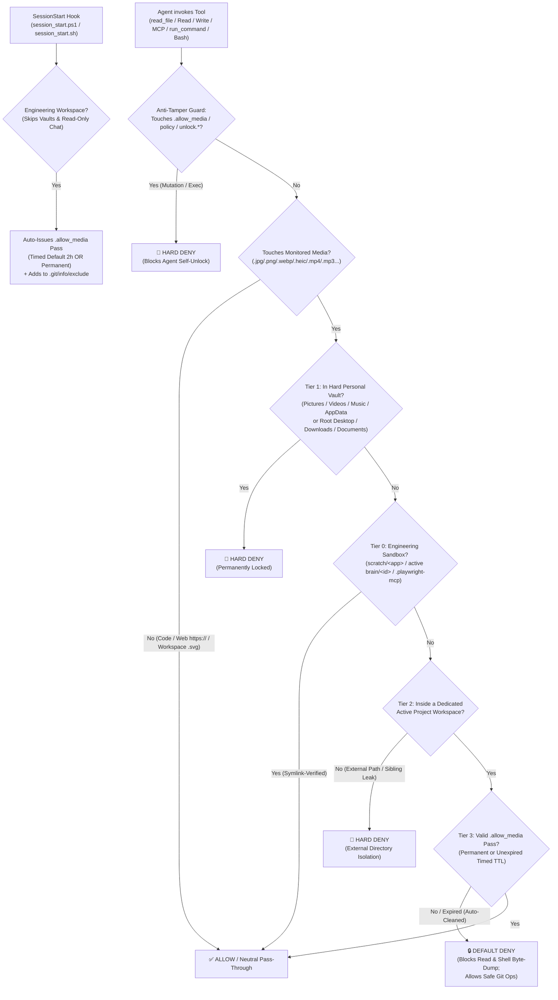

<div align="center">


# 🕶️ agent-blindfold

### *"Keep your AI Agent's eyes on the code, not on your private stash."*

**Codename: `Heart-Under-Blade` (`刃下心`) · v1.1**

[](https://github.com/zanex-dev/agent-blindfold/actions/workflows/ci.yml)
[](./LICENSE)
[](#quick-start--one-click-install)
[](#quick-start--one-click-install)
[](#architecture--smart-4-tier-defense)

**English** | [简体中文](./README_zh.md) · [Changelog](./CHANGELOG.md)

</div>

---

## ⚡ Why `agent-blindfold`? (Privacy & Anti-Ban Shield)

Modern AI Coding Agents (**Google Antigravity**, **Claude Code**, etc.) are natively multimodal—whenever an agent invokes `read_file`, `Read`, or an MCP inspection tool on a local image, video, or audio file, the raw binary bytes are immediately uploaded to cloud multimodal endpoints.

Relying solely on system prompts (`GEMINI.md` / `CLAUDE.md`) is a **gentleman's agreement**, not a security boundary:
1. **Irreversible Privacy Leakage**: During broad directory scans, parallel subagent exploration, or long-context attention decay, an agent can accidentally read personal photos, screen recordings, or cached chat media in `Pictures`, `Downloads`, `Desktop`, or `AppData`. Once transmitted to the cloud, it cannot be undone.
2. **False-Positive Account Bans (Anti-Ban Shield)**: Cloud safety classifiers automatically audit uploaded visual media. If an agent accidentally reads local anime illustrations (e.g., *Monogatari* / Oshino Shinobu artwork), game CGs, or private artwork on your disk, automated cloud moderation can flag your account and trigger an immediate, irreversible **account suspension**.

**`agent-blindfold` (`Heart-Under-Blade / 刃下心`)** enforces **Dual-Layer Zero-Trust Protection** without blinding frontend/UI engineering:
- **Layer 1 — Soft Prompt Discipline (`rules/AGENTS.md`)**: Instructs the agent upfront to skip personal/external binary media while permitting legitimate UI/frontend verification assets.
- **Layer 2 — Hard OS Physical Firewall (`SessionStart` + `PreToolUse` Hooks)**: Automatically grants **Timed (TTL)** or **Permanent** workspace passes at the start of engineering sessions, exempts UI sandboxes (`scratch`, `brain`, `.playwright-mcp`, `.svg`), and physically blocks personal vaults, external directories, and Agent self-unlock tampering milliseconds before disk access.

---

## 🛡️ Architecture & Smart 4-Tier Defense



### Monitored Media Extensions
- **Images**: `.jpg`, `.jpeg`, `.png`, `.gif`, `.webp`, `.bmp`, `.ico`, `.heic`, `.heif`, `.avif` *(Note: plain-text `.svg` vector icons inside project workspaces and engineering sandboxes are exempted so frontend UI development is never disrupted; `.svg` inside personal vaults remains blocked).*
- **Video**: `.mp4`, `.mkv`, `.avi`, `.mov`, `.webm`, `.flv`, `.wmv`
- **Audio**: `.mp3`, `.wav`, `.flac`, `.m4a`, `.ogg`, `.aac`

### Smart Four-Tier Policy
| Tier | Scope | Policy | Real-World Behavior |
| :--- | :--- | :--- | :--- |
| **Tier 1: Hard Personal Vaults** | `Pictures`, `Videos`, `Music`, `AppData`, plus root `Desktop`, `Downloads`, `Documents` | **Unconditional `deny`** | Permanently locked—even if `~/Downloads` itself is opened as a workspace or contains `.allow_media`. Evaluated **after** symlink/junction resolution. |
| **Tier 0: Engineering Sandboxes** | `~/.gemini/antigravity/scratch/<subproject>`, active `artifactDirectoryPath` (`brain/<current-id>`), `<workspace>/.playwright-mcp/` | **Auto-Exempt (`allow`)** | Keeps frontend/SVG/Playwright UI visual checks working seamlessly even when no Active Workspace is mounted, while blocking cross-session `.user_uploaded/` leaks. |
| **Tier 2: External Directories** | Any path outside your active dedicated project workspace (`workspacePaths` / `cwd`) | **Unconditional `deny`** | Blocks cross-drive snooping, `../` traversals, symlinks, and sibling files in parent folders. |
| **Tier 3: Dedicated Project Workspace** | Project assets inside a specific repo (including repos cloned under `~/Downloads/my-app` or `~/Desktop/my-app`) | **`SessionStart` Auto-Pass (`timed` / `permanent`) or Manual Pass** | Automatically receives a timed (`2h` default) or permanent `.allow_media` pass at session start (configurable to `off` for strict manual mode); expired passes auto-clean themselves. |

### Built-In Bypass & Anti-Tamper Hardening
- **Anti-Tamper Guard (Zero Self-Unlock)**: Intercepts `write_file`, `edit_file`, `Write`, `Edit`, `MultiEdit`, MCP write tools, and terminal commands (`run_command` / `Bash`) so AI Agents can **never** create, edit, forge, or delete `.allow_media`, `agent-blindfold.json`, or run `unlock.ps1` / `unlock.sh`.
- **Shell / Terminal Guard (`run_command` & `Bash`)**: Blocks directory scans on `Pictures`/`Videos`/`Music`, blocks shell commands touching personal/external media, blocks command-chained `git` spoofing (`git status && base64 a.png`), and blocks content-encoding bypasses (`base64`, `certutil`, `xxd`, `PIL`, `cv2`, `ffmpeg`, `magick`, `tesseract`) on locked workspace media—without breaking `git status`, `git add`, or `git commit`.
- **MCP & URI Normalization**: Inspects nested `call_mcp_tool` arguments (`markitdown`, `filesystem`, `playwright`), decodes percent-encoded `file://` URIs (`%20`), strips NTFS `::$DATA` streams, resolves symlinks, and ignores public `https://` web URLs.
- **Zero Permission Hijacking on Claude Code**: Exits `0` with **empty `stdout`** when allowing a tool call or `SessionStart` event on Claude Code, deferring cleanly to Claude Code's native permission prompts.
- **Windows `cmd /c` Clean Stream**: Writes raw UTF-8 (no BOM) bytes directly to `stdout` and uses quote-free invocation so Windows `CreateProcess` never corrupts `protojson` with `\"` escaping.

---

## 🚀 Quick Start & One-Click Install

### 1. Clone the Repository
```bash
git clone https://github.com/zanex-dev/agent-blindfold.git
cd agent-blindfold
```

### 2. One-Click Global Install (Configurable Timed vs. Permanent Auto-Grant)

By default, the installer enables **Timed (`2h`)** automatic exemption at `SessionStart` (`~/.gemini/config/agent-blindfold.json`), installs the **Google Antigravity** native plugin (`~/.gemini/config/plugins/agent-blindfold`), and losslessly merges `SessionStart` + `PreToolUse` hooks into **Claude Code** (`~/.claude/settings.json` with `.bak` backup):

#### Windows (PowerShell)
```powershell
# Default: Timed 2h auto-exemption at session start
powershell -ExecutionPolicy Bypass -File .\install.ps1

# Optional: Permanent auto-exemption for engineering workspaces, or 'off' for manual-only
powershell -ExecutionPolicy Bypass -File .\install.ps1 -AutoGrant permanent
powershell -ExecutionPolicy Bypass -File .\install.ps1 -AutoGrant timed -DefaultTTL 4h
```

#### macOS / Linux (Bash)
```bash
chmod +x ./install.sh ./scripts/*.sh
./install.sh

# Optional: Permanent auto-exemption or custom TTL
./install.sh --auto-grant permanent
./install.sh --auto-grant timed --ttl 4h
```

### 3. One-Click Clean Uninstall
```powershell
# Windows
powershell -ExecutionPolicy Bypass -File .\install.ps1 -Uninstall
```
```bash
# macOS / Linux
./install.sh --uninstall
```

### 4. Live Toggle in Google Antigravity (Zero Restart)
Because `agent-blindfold` ships as a native Antigravity plugin bundle, you can temporarily pause or resume all hooks & rules live—without uninstalling or restarting the app—via **Customizations → Plugins → Agent Blindfold** (or via chat link `customization://agent-blindfold`) whenever debugging or updating the firewall itself.

---

## 🔓 Timed vs. Permanent Workspace Passes (`unlock` CLI & Controller)

You can switch global `SessionStart` policy or issue/revoke per-workspace passes at any time from your own terminal (or by double-clicking **`blindfold-control.cmd`** on Windows):

### Windows PowerShell (`scripts/unlock.ps1`)
```powershell
# Grant a 2-hour timed pass (auto-expires & cleans up; hidden via .git/info/exclude)
powershell -ExecutionPolicy Bypass -File .\scripts\unlock.ps1 -Mode timed -TTL 2h -Workspace C:\path\to\my-app

# Grant a permanent pass to a trusted frontend project
powershell -ExecutionPolicy Bypass -File .\scripts\unlock.ps1 -Mode permanent -Workspace C:\path\to\my-app

# Check current workspace pass & global SessionStart policy
powershell -ExecutionPolicy Bypass -File .\scripts\unlock.ps1 -Status -Workspace C:\path\to\my-app

# Revoke pass immediately (re-lock workspace)
powershell -ExecutionPolicy Bypass -File .\scripts\unlock.ps1 -Lock -Workspace C:\path\to\my-app

# Switch global SessionStart auto-grant policy (timed | permanent | off)
powershell -ExecutionPolicy Bypass -File .\scripts\unlock.ps1 -GlobalAutoGrant permanent
```

### macOS / Linux (`scripts/unlock.sh`)
```bash
./scripts/unlock.sh --timed 2h --workspace /path/to/my-app
./scripts/unlock.sh --permanent --workspace /path/to/my-app
./scripts/unlock.sh --status --workspace /path/to/my-app
./scripts/unlock.sh --lock --workspace /path/to/my-app
./scripts/unlock.sh --global-auto-grant permanent
```

### Rejection Message Language (`AGENT_BLINDFOLD_LANG`)
By default, block reasons are emitted in concise **English + Chinese** (`bilingual`). Customize via environment variable:
- `AGENT_BLINDFOLD_LANG=en` — English only
- `AGENT_BLINDFOLD_LANG=zh` — Simplified Chinese only
- `AGENT_BLINDFOLD_LANG=bilingual` — Default (`English | 中文`)

---

## 🧪 Running the Automated Test Suite

`agent-blindfold` ships with a comprehensive cross-platform end-to-end security & sandboxed installer test suite (`tests/run_tests.py`) with zero external dependencies:

```bash
python tests/run_tests.py
```

---

## 📂 Repository Structure

```text
agent-blindfold/
├── .github/workflows/
│   └── ci.yml                 # Multi-OS GitHub Actions CI (Windows, Ubuntu, macOS)
├── assets/
│   └── shinobu-banner.svg     # Project vector banner (Heart-Under-Blade)
├── docs/
│   └── v1.1-exemption-design.md # Architecture & security specification for v1.1
├── rules/
│   └── AGENTS.md              # Layer 1 soft prompt media-isolation rule (Antigravity Plugin)
├── scripts/
│   ├── guard.ps1              # Windows PowerShell PreToolUse firewall + Anti-Tamper Guard
│   ├── guard.sh               # macOS / Linux PreToolUse firewall + Anti-Tamper Guard
│   ├── session_start.ps1      # Windows SessionStart auto-exemption hook (timed / permanent)
│   ├── session_start.sh       # macOS / Linux SessionStart auto-exemption hook
│   ├── unlock.ps1             # Windows pass issuer & global policy CLI / interactive wizard
│   └── unlock.sh              # macOS / Linux pass issuer & global policy CLI
├── tests/
│   └── run_tests.py           # Cross-platform E2E security, SessionStart & installer test suite
├── blindfold-control.cmd      # Windows one-click interactive exemption control launcher
├── .gitattributes             # Enforces LF on .sh and CRLF on .ps1/.cmd across Git checkouts
├── hooks.json                 # Native Antigravity SessionStart + PreToolUse hook manifest
├── plugin.json                # Native Antigravity plugin manifest
├── install.ps1                # Windows idempotent installer & uninstaller
├── install.sh                 # macOS / Linux idempotent installer & uninstaller
├── SECURITY.md                # Threat model & vulnerability reporting policy
├── CHANGELOG.md               # Release history
├── README.md                  # English documentation
├── README_zh.md               # Simplified Chinese documentation
└── LICENSE                    # MIT License
```

---

## 📜 License

Released under the [MIT License](./LICENSE).  
`Copyright (c) 2026 琢玹 (zanex)`
