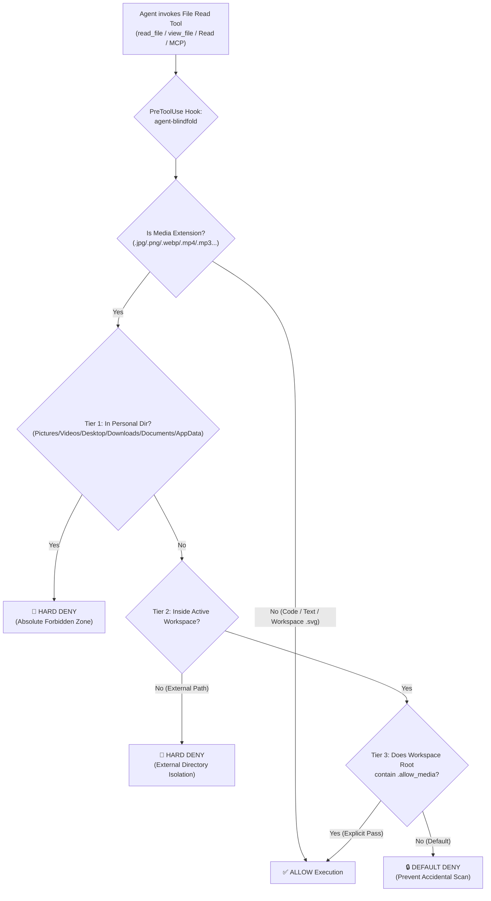

<div align="center">


# 🕶️ agent-blindfold

### *"Keep your AI Agent's eyes on the code, not on your private stash."*

**Codename: `Heart-Under-Blade` (`刃下心`)**

[](#license)
[](#quick-start--one-click-install)
[](#quick-start--one-click-install)
[](#architecture--3-tier-defense)

**English** | [简体中文](./README_zh.md)

</div>

---

## ⚡ Why `agent-blindfold`? (Privacy & Anti-Ban Shield)

Modern AI Coding Agents (**Google Antigravity**, **Claude Code**, etc.) possess multimodal capabilities—when they invoke `read_file` or `Read` on an image, video, or audio file, the raw binary bytes are immediately transmitted to cloud multimodal APIs.

Relying solely on system prompts (`GEMINI.md` / `CLAUDE.md`) is a **gentleman's agreement**, not a security boundary:
1. **Irreversible Privacy Leakage**: During broad directory scans, subagent parallel exploration, or long-context attention decay, an agent can accidentally read personal photos, screen recordings, or documents in `Pictures`, `Downloads`, or `Desktop`. Once sent to the cloud, it cannot be undone.
2. **False-Positive Account Bans (Anti-Ban Shield)**: Cloud safety filters strictly and automatically audit uploaded visual media. If an agent accidentally reads local anime illustrations (e.g., *Monogatari* / Oshino Shinobu artwork), game CGs, or private media on your disk, automated cloud moderation can flag your account and trigger an immediate, irreversible **account suspension**.

**`agent-blindfold` (`Heart-Under-Blade / 刃下心`)** moves this boundary from *prompt-level advice* to a **deterministic OS-level `PreToolUse` physical firewall**. Before any file-reading tool touches the disk, `agent-blindfold` inspects the target path and blocks unauthorized media access at the execution gate.

---

## 🛡️ Architecture & 3-Tier Defense



### Monitored Media Extensions
- **Images**: `.jpg`, `.jpeg`, `.png`, `.gif`, `.webp`, `.bmp`, `.ico` *(Note: `.svg` vector code inside project workspaces is exempted so frontend icon editing is never disrupted; `.svg` inside personal directories remains blocked).*
- **Video**: `.mp4`, `.mkv`, `.avi`, `.mov`, `.webm`, `.flv`
- **Audio**: `.mp3`, `.wav`, `.flac`

### Three-Tier Policy
| Tier | Scope | Policy | Behavior |
| :--- | :--- | :--- | :--- |
| **Tier 1: Absolute Forbidden Zone** | `Pictures`, `Videos`, `Desktop`, `Downloads`, `Documents`, `AppData` | **Unconditional `deny`** | Permanently locked—even if one of these folders is opened as a workspace or contains `.allow_media`. |
| **Tier 2: External Directories** | Any path outside the current active project workspace (`workspacePaths` / `cwd`) | **Unconditional `deny`** | Prevents cross-directory snooping on other drives or folders. |
| **Tier 3: Inside Project Workspace** | Project assets (e.g., `./src/assets/banner.png`) | **Default `deny` + `.allow_media` Pass** | Blocked by default to prevent subagents from scanning assets; instantly unlocked when `.allow_media` exists in the workspace root. |

---

## 🚀 Quick Start & One-Click Install

### 1. Clone the Repository
```bash
git clone https://github.com/zanex/agent-blindfold.git
cd agent-blindfold
```

### 2. One-Click Global Installation

#### Windows (PowerShell)
```powershell
powershell -ExecutionPolicy Bypass -File .\install.ps1
```

#### macOS / Linux (Bash)
```bash
chmod +x ./install.sh ./scripts/guard.sh
./install.sh
```

### 3. Manual Hook Registration (Optional)

#### For Google Antigravity (`~/.gemini/config/hooks.json` or `.agents/hooks.json`)
```json
{
  "agent-blindfold": {
    "PreToolUse": [
      {
        "matcher": "read_file|view_file|read_resource",
        "hooks": [
          {
            "type": "command",
            "command": "powershell -NoProfile -NonInteractive -ExecutionPolicy Bypass -File C:/path/to/agent-blindfold/scripts/guard.ps1"
          }
        ]
      }
    ]
  }
}
```

#### For Claude Code (`~/.claude/settings.json`)
```json
{
  "hooks": {
    "PreToolUse": [
      {
        "matcher": "Read|View",
        "hooks": [
          {
            "type": "command",
            "command": "powershell -NoProfile -NonInteractive -ExecutionPolicy Bypass -File C:/path/to/agent-blindfold/scripts/guard.ps1"
          }
        ]
      }
    ]
  }
}
```

---

## 🔓 Temporary Workspace Unlock (`.allow_media`)

When you are debugging UI and **explicitly want** the Agent to inspect an image inside your active project workspace:

1. **Unlock** (Create `.allow_media` in your project root):
   ```bash
   # macOS / Linux / Git Bash
   touch .allow_media

   # Windows PowerShell
   New-Item -ItemType File -Path .\.allow_media -Force
   ```
2. **Re-lock** (Remove `.allow_media` when done):
   ```bash
   rm .allow_media
   ```

*(Tip: Add `.allow_media` to your global `.gitignore` so it is never committed.)*

---

## 📂 Repository Structure

```text
agent-blindfold/
├── assets/
│   └── .gitkeep           # Reserved for ./assets/shinobu-banner.png
├── scripts/
│   ├── guard.ps1          # Windows PowerShell PreToolUse interceptor (UTF-8 clean JSON)
│   └── guard.sh           # macOS / Linux PreToolUse interceptor
├── hooks.json             # Native Antigravity hook manifest
├── plugin.json            # Native Antigravity plugin manifest
├── install.ps1            # Windows one-click installer
├── install.sh             # macOS / Linux one-click installer
├── README.md              # English documentation
├── README_zh.md           # Simplified Chinese documentation
└── LICENSE                # MIT License
```

---

## 📜 License

Released under the [MIT License](./LICENSE).  
`Copyright (c) 2026 琢玹 (zanex)`
