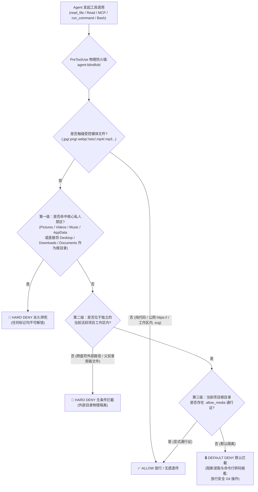

<div align="center">


# 🕶️ agent-blindfold

### *"Keep your AI Agent's eyes on the code, not on your private stash."*

**项目代号：`Heart-Under-Blade` (`刃下心`)**

[](https://github.com/zanex/agent-blindfold/actions/workflows/ci.yml)
[](./LICENSE)
[](#快速开始与一键安装)
[](#快速开始与一键安装)
[](#智能三级防御架构)

[English](./README.md) | **简体中文**

</div>

---

## ⚡ 为什么需要 `agent-blindfold`？（隐私保护与防误封护盾）

如今的本地 AI 编程助手（如 **Google Antigravity**、**Claude Code** 等）均具备原生多模态读取能力——一旦 Agent 对本地图片、音视频调用了 `read_file`、`Read` 或多模态 MCP 工具，文件的原始字节流就会瞬间被编码并上传至云端大模型接口。

仅仅依靠在 `GEMINI.md` 或 `CLAUDE.md` 中编写提示词规则，本质上只是一纸**“君子协定”**，而非物理安全边界：
1. **不可逆的个人隐私泄露**：当派发多个子智能体（Subagents）并发扫描目录、或长上下文导致模型注意力衰减时，Agent 极易在遍历目录时误读 `Pictures`、`Downloads`、`Desktop` 或 `AppData`（微信/Telegram/浏览器缓存）中的私人照片、截图或视频。多模态数据一旦上云便不可撤回。
2. **云端风控误判与高价值账号封禁风险（Anti-Ban Shield）**：海外云端大模型接口对上传的视觉素材有着极其严苛的自动化安全审查机制。一旦 Agent 在扫盘时误读了你本地硬盘里的二次元插画（例如《物语系列》忍野忍插画、动漫壁纸、游戏拆包 CG 等），极易触发云端审核模型的误判，直接导致高价值的开发者账号或订阅额度被**无预警封禁**。

**`agent-blindfold`（代号：`Heart-Under-Blade / 刃下心`）** 提供**“软硬双层零信任防护”**：
- **第一层：软约束提示词纪律（`rules/AGENTS.md`）**：随插件自动注入，提前告知 Agent 在扫描目录时主动跳过二进制媒体文件，避免无谓消耗 Token。
- **第二层：系统级物理防火墙（`PreToolUse` Hook）**：在文件读取、MCP 嵌套调用、`file://` URI、符号链接以及终端命令行（如 `base64`、`PIL`、`ffmpeg`）触碰硬盘的前一毫秒，直接从宿主进程层一票否决（`deny`）。

---

## 🛡️ 智能三级防御架构



### 监控文件后缀范围
- **图片格式**：`.jpg`, `.jpeg`, `.png`, `.gif`, `.webp`, `.bmp`, `.ico`, `.heic`, `.heif`, `.avif` *（注：位于独立工程工作区内部的 `.svg` 纯文本矢量图标自动豁免，确保前端开发修改图标组件零干扰；个人敏感目录内的 `.svg` 依然严格拦截）。*
- **视频格式**：`.mp4`, `.mkv`, `.avi`, `.mov`, `.webm`, `.flv`, `.wmv`
- **音频格式**：`.mp3`, `.wav`, `.flac`, `.m4a`, `.ogg`, `.aac`

### 智能三级管控策略
| 防御级别 | 命中范围 | 执行动作 | 实战行为说明 |
| :--- | :--- | :--- | :--- |
| **第一级：核心私人禁区** | `Pictures`, `Videos`, `Music`, `AppData`，以及直接访问或直接设为工作区的 `Desktop`, `Downloads`, `Documents` | **无条件 `deny`** | 物理焊死——哪怕误把整个 `Downloads` 设为工作区并放入 `.allow_media`，也绝不放行。 |
| **第二级：外部目录隔离** | 不在当前独立项目工作区（`workspacePaths` / `cwd`）内的任何本地路径 | **无条件 `deny`** | 严防跨盘符越界读取、`../` 目录穿越、符号链接逃逸及同级私人文件泄露。 |
| **第三级：独立工程工作区** | 具体工程目录内的项目素材（智能兼容克隆在 `~/Downloads/my-app` 或 `~/Desktop/my-app` 下的子工程！） | **默认 `deny` + 标记放行** | 默认隔离防子智能体误扫（同时无感放行 `git add` / `git commit`）；工程根目录存在 `.allow_media` 时立即解锁。 |

### 内置防绕过与工程级细节优化
- **终端命令防绕过（`run_command` & `Bash`）**：自动拦截针对 `Pictures`/`Videos`/`Music` 的目录枚举，拦截触碰外部/私人媒体的终端命令，并拦截在未授权时使用 `base64`、`certutil`、`xxd`、`PIL`、`cv2`、`ffmpeg`、`magick`、`tesseract` 等工具对项目图片进行转码/解析的“曲线偷看”行为，同时确保 `git status`、`git add`、`git commit` 等日常研发命令畅通无阻。
- **MCP 深度解析与 URI 归一化**：穿透检查 `call_mcp_tool` 嵌套参数（如 `markitdown`、`filesystem`、`playwright`），自动解码 `file://` URL 编码（如 `%20` 空格），解析真实符号链接目标，并精准放行公网 `https://` 网页图片链接。
- **Claude Code 零权限劫持**：在 Claude Code 下放行工具时采用“退出码 `0` + 空 `stdout`”的官方中立透传规范，绝不覆盖或自动批准用户原有的 `Bash` 权限确认弹窗。
- **Windows 纯净无转义字节流**：底层直写无 BOM 的 UTF-8 字节流，并采用无双引号点号加载（`. '...'`），彻底根除 Windows `cmd /c` 进程调用链多出 `\"` 导致 `protojson` 解析崩溃的顽疾。

---

## 🚀 快速开始与一键安装

### 1. 克隆仓库
```bash
git clone https://github.com/zanex/agent-blindfold.git
cd agent-blindfold
```

### 2. 一键全局安装（幂等防重 · 无损合并）

安装脚本会自动部署 **Google Antigravity** 全局原生插件（`~/.gemini/config/plugins/agent-blindfold`），并在不破坏任何既有配置的前提下将钩子无损合并进 **Claude Code** 的 `~/.claude/settings.json`（自动生成 `.bak` 备份）：

#### Windows (PowerShell)
```powershell
powershell -ExecutionPolicy Bypass -File .\install.ps1
```

#### macOS / Linux (Bash)
```bash
chmod +x ./install.sh ./scripts/guard.sh
./install.sh
```

### 3. 一键干净卸载
```powershell
# Windows
powershell -ExecutionPolicy Bypass -File .\install.ps1 -Uninstall
```
```bash
# macOS / Linux
./install.sh --uninstall
```

### 4. 手动挂载配置（可选）

#### Google Antigravity (`~/.gemini/config/hooks.json` 或 `.agents/hooks.json`)
```json
{
  "agent-blindfold": {
    "PreToolUse": [
      {
        "matcher": "read_file|view_file|read_resource|run_command|call_mcp_tool",
        "hooks": [
          {
            "type": "command",
            "command": "powershell -NoProfile -NonInteractive -ExecutionPolicy Bypass -Command . 'C:/path/to/agent-blindfold/scripts/guard.ps1'"
          }
        ]
      }
    ]
  }
}
```

#### Claude Code (`~/.claude/settings.json`)
```json
{
  "hooks": {
    "PreToolUse": [
      {
        "matcher": "Read|View|NotebookRead|Bash|mcp__.*",
        "hooks": [
          {
            "type": "command",
            "command": "powershell -NoProfile -NonInteractive -ExecutionPolicy Bypass -Command . 'C:/path/to/agent-blindfold/scripts/guard.ps1'"
          }
        ]
      }
    ]
  }
}
```

---

## 🔓 工作区内媒体临时放行（`.allow_media`）与语言切换

当你正在调试前端 UI，**明确需要**让 Agent 查看当前代码仓库内的某张设计图或素材时，无需修改任何配置：

1. **开启临时通行证**（在当前工程根目录创建 `.allow_media` 文件）：
   ```powershell
   # Windows PowerShell
   New-Item -ItemType File -Path .\.allow_media -Force
   ```
   ```bash
   # macOS / Linux
   touch .allow_media
   ```
2. **用完即焚（恢复锁死）**：
   ```powershell
   Remove-Item .\.allow_media -Force
   ```

### 拦截提示语语言切换（`AGENT_BLINDFOLD_LANG`）
默认输出**中英双语**拦截原因（`bilingual`），可通过系统环境变量自由切换：
- `AGENT_BLINDFOLD_LANG=zh` — 仅输出简体中文
- `AGENT_BLINDFOLD_LANG=en` — 仅输出英文
- `AGENT_BLINDFOLD_LANG=bilingual` — 默认中英双语

---

## 🧪 运行自动化安全测试套件

仓库内置零第三方依赖的 18 项跨平台端到端安全测试与沙盒安装/卸载验证套件（`tests/run_tests.py`）：

```bash
python tests/run_tests.py
```

---

## 📂 仓库目录结构

```text
agent-blindfold/
├── .github/workflows/
│   └── ci.yml             # GitHub Actions 三大操作系统矩阵 CI (Windows / Ubuntu / macOS)
├── assets/
│   └── .gitkeep           # 预留顶部横幅配图位 (./assets/shinobu-banner.png)
├── rules/
│   └── AGENTS.md          # 第一层提示词媒体隔离软规则 (随 Antigravity 插件自动生效)
├── scripts/
│   ├── guard.ps1          # Windows PowerShell 物理防火墙引擎 (无 BOM 纯净 UTF-8 输出)
│   └── guard.sh           # macOS / Linux 物理防火墙引擎
├── tests/
│   └── run_tests.py       # 18 项跨平台双协议与沙盒安装器自动化测试套件
├── .gitattributes         # 跨平台行尾符锁死契约 (.sh 强制 LF / .ps1 强制 CRLF)
├── hooks.json             # Antigravity 原生 Hook 清单
├── plugin.json            # Antigravity 原生插件清单
├── install.ps1            # Windows 幂等一键安装与无损卸载脚本
├── install.sh             # macOS / Linux 幂等一键安装与无损卸载脚本
├── SECURITY.md            # 威胁模型边界说明与漏洞披露指南
├── CHANGELOG.md           # 版本演进日志
├── README.md              # 英文主文档
├── README_zh.md           # 简体中文说明文档
└── LICENSE                # MIT 开源协议
```

---

## 📜 开源协议 (License)

本项目基于 [MIT License](./LICENSE) 开源发布。  
`Copyright (c) 2026 琢玹 (zanex)`
