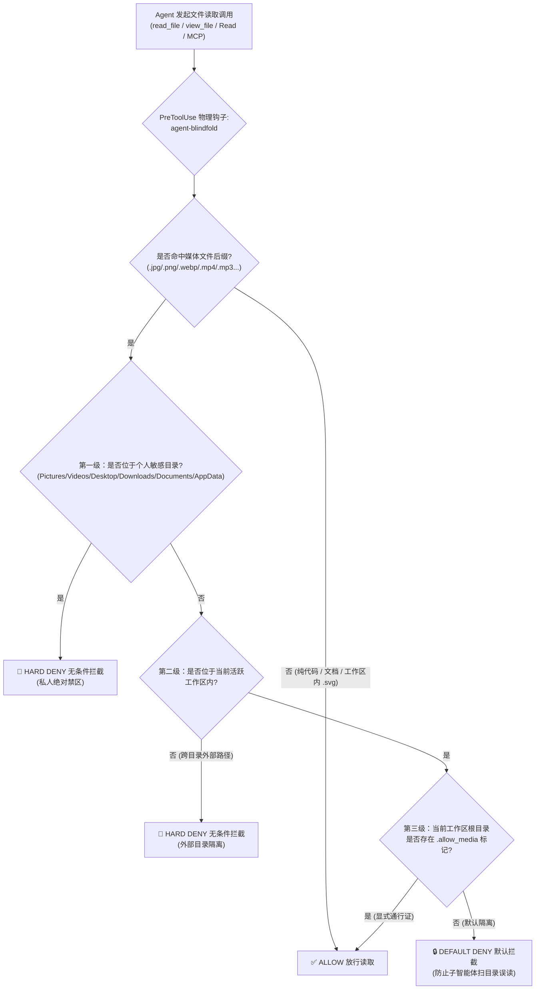

<div align="center">


# 🕶️ agent-blindfold

### *"Keep your AI Agent's eyes on the code, not on your private stash."*

**项目代号：`Heart-Under-Blade` (`刃下心`)**

[](#开源协议-license)
[](#快速开始与一键安装)
[](#快速开始与一键安装)
[](#三级防御架构)

[English](./README.md) | **简体中文**

</div>

---

## ⚡ 为什么需要 `agent-blindfold`？（隐私保护与防误封护盾）

如今的本地 AI 编程助手（如 **Google Antigravity**、**Claude Code** 等）均具备原生多模态读取能力——一旦 Agent 对本地图片、音视频调用了 `read_file` 或 `Read` 工具，文件的原始字节流就会瞬间被编码并发送至云端多模态大模型接口。

如果仅仅依靠在 `GEMINI.md` 或 `CLAUDE.md` 中写提示词约束，本质上只是一纸**“君子协定”**，而非物理安全边界：
1. **不可逆的个人隐私泄露**：当派发多个子智能体（Subagents）并发扫描目录、或者长上下文导致模型注意力衰减时，Agent 极易在遍历文件时手滑读取 `Pictures`、`Downloads`、`Desktop` 中的私人照片、截图或视频。多模态数据一旦上云便不可撤回。
2. **云端风控误判与账号封禁风险（Anti-Ban Shield）**：海外云端大模型接口对上传的图片素材有着极其严苛的自动化安全审查机制。一旦 Agent 在扫描目录时误读了你本地硬盘里的二次元插画（例如《物语系列》忍野忍插画、动漫壁纸、游戏拆包立绘等），极易触发云端多模态审核模型的误判，直接导致高价值的开发者账号或订阅额度被**无预警封禁**。

**`agent-blindfold`（代号：`Heart-Under-Blade / 刃下心`）** 将这道防线从“提示词软约束”升级为**系统底层的 `PreToolUse` 物理级防火墙**。在文件读取工具触碰硬盘的前一毫秒，直接从宿主进程层校验路径并一票否决（`deny`）。

---

## 🛡️ 三级防御架构



### 拦截后缀范围
- **图片格式**：`.jpg`, `.jpeg`, `.png`, `.gif`, `.webp`, `.bmp`, `.ico` *（注：位于工程工作区内部的 `.svg` 纯文本矢量图标自动豁免，确保前端开发修改图标组件不受影响；个人敏感目录内的 `.svg` 依然拦截）。*
- **视频格式**：`.mp4`, `.mkv`, `.avi`, `.mov`, `.webm`, `.flv`
- **音频格式**：`.mp3`, `.wav`, `.flac`

### 三级管控策略一览
| 防御级别 | 命中范围 | 执行动作 | 设计意图 |
| :--- | :--- | :--- | :--- |
| **第一级：私人绝对禁区** | `Pictures`, `Videos`, `Desktop`, `Downloads`, `Documents`, `AppData` | **无条件 `deny`** | 物理焊死，哪怕将该目录设为工作区或放置 `.allow_media` 也绝不放行。 |
| **第二级：工作区外部目录** | 不在当前活跃工程目录（`workspacePaths` / `cwd`）内的任何路径 | **无条件 `deny`** | 严防 Agent 跨盘符或跨文件夹越界读取非当前工程的媒体文件。 |
| **第三级：工作区内部素材** | 当前代码仓库内的媒体资源（如 `./src/assets/hero.png`） | **默认 `deny` + 标记放行** | 平时默认锁死防误扫；需要调试 UI 素材时，在工程根目录创建 `.allow_media` 即可一键放行。 |

---

## 🚀 快速开始与一键安装

### 1. 克隆仓库
```bash
git clone https://github.com/zanex/agent-blindfold.git
cd agent-blindfold
```

### 2. 一键全局安装

#### Windows (PowerShell)
```powershell
powershell -ExecutionPolicy Bypass -File .\install.ps1
```

#### macOS / Linux (Bash)
```bash
chmod +x ./install.sh ./scripts/guard.sh
./install.sh
```

### 3. 手动挂载配置（可选）

#### Google Antigravity (`~/.gemini/config/hooks.json` 或 `.agents/hooks.json`)
```json
{
  "agent-blindfold": {
    "PreToolUse": [
      {
        "matcher": "read_file|view_file|read_resource",
        "hooks": [
          {
            "type": "command",
            "command": "powershell -NoProfile -NonInteractive -ExecutionPolicy Bypass -File C:/path/to/agent-blindfold/scripts/guard.ps1"
          }
        ]
      }
    ]
  }
}
```

#### Claude Code (`~/.claude/settings.json`)
```json
{
  "hooks": {
    "PreToolUse": [
      {
        "matcher": "Read|View",
        "hooks": [
          {
            "type": "command",
            "command": "powershell -NoProfile -NonInteractive -ExecutionPolicy Bypass -File C:/path/to/agent-blindfold/scripts/guard.ps1"
          }
        ]
      }
    ]
  }
}
```

---

## 🔓 工作区内媒体文件临时放行指南（`.allow_media`）

当你在开发前端界面或游戏工程，**明确需要**让 Agent 查看当前代码仓库里的某张设计稿或素材图时，无需修改 Hook 源码：

1. **开启临时通行证**（在当前工程根目录创建空文件 `.allow_media`）：
   ```powershell
   # Windows PowerShell
   New-Item -ItemType File -Path .\.allow_media -Force

   # macOS / Linux / Git Bash
   touch .allow_media
   ```
2. **用完即焚（恢复锁死）**：
   ```powershell
   Remove-Item .\.allow_media -Force
   ```

---

## 📂 仓库目录结构

```text
agent-blindfold/
├── assets/
│   └── .gitkeep           # 预留顶部横幅配图位 (./assets/shinobu-banner.png)
├── scripts/
│   ├── guard.ps1          # Windows PowerShell 核心拦截脚本（纯净 UTF-8 单行 JSON 输出）
│   └── guard.sh           # macOS / Linux 核心拦截脚本
├── hooks.json             # Antigravity 原生 Hook 配置文件
├── plugin.json            # Antigravity 原生插件清单文件
├── install.ps1            # Windows 一键部署脚本
├── install.sh             # macOS / Linux 一键部署脚本
├── README.md              # 英文主文档
├── README_zh.md           # 简体中文说明文档
└── LICENSE                # MIT 开源协议
```

---

## 📜 开源协议 (License)

本项目基于 [MIT License](./LICENSE) 开源发布。  
`Copyright (c) 2026 琢玹 (zanex)`
