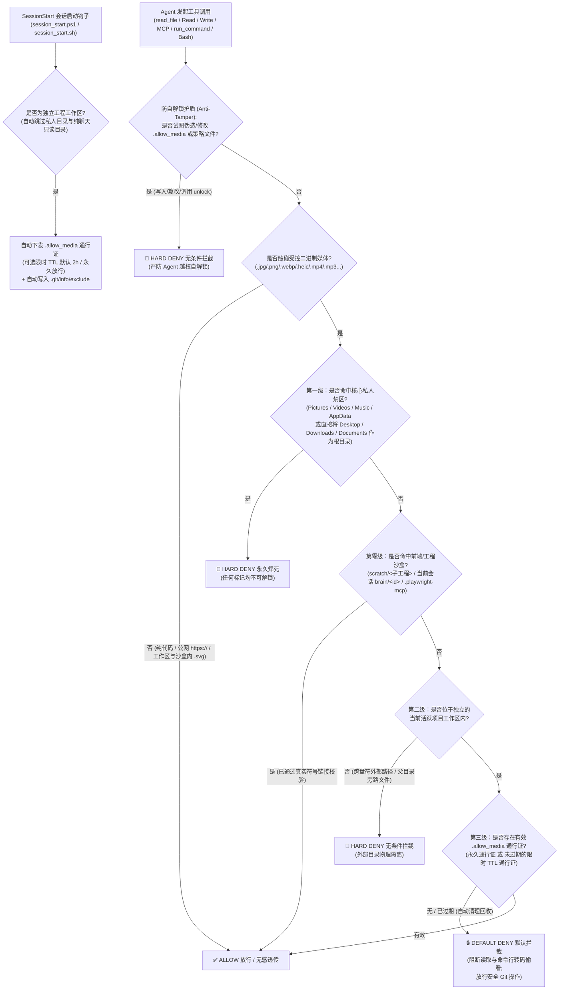

<div align="center">


# 🕶️ agent-blindfold

### *"Keep your AI Agent's eyes on the code, not on your private stash."*

**项目代号：`Heart-Under-Blade` (`刃下心`) · v1.1**

[](https://github.com/zanex-dev/agent-blindfold/actions/workflows/ci.yml)
[](./LICENSE)
[](#快速开始与一键安装)
[](#快速开始与一键安装)
[](#智能四级防御与自动豁免架构)

[English](./README.md) | **简体中文**

</div>

---

## ⚡ 为什么需要 `agent-blindfold`？（隐私保护与防误封护盾）

如今的本地 AI 编程助手（如 **Google Antigravity**、**Claude Code** 等）均具备原生多模态读取能力——一旦 Agent 对本地图片、音视频调用了 `read_file`、`Read` 或多模态 MCP 工具，文件的原始字节流就会瞬间被编码并上传至云端大模型接口。

仅仅依靠在 `GEMINI.md` 或 `CLAUDE.md` 中编写提示词规则，本质上只是一纸**“君子协定”**，而非物理安全边界：
1. **不可逆的个人隐私泄露**：当派发多个子智能体（Subagents）并发扫描目录、或长上下文导致模型注意力衰减时，Agent 极易在遍历目录时误读 `Pictures`、`Downloads`、`Desktop` 或 `AppData`（微信/Telegram/浏览器缓存）中的私人照片、截图或视频。多模态数据一旦上云便不可撤回。
2. **云端风控误判与高价值账号封禁风险（Anti-Ban Shield）**：海外云端大模型接口对上传的视觉素材有着极其严苛的自动化安全审查机制。一旦 Agent 在扫盘时误读了你本地硬盘里的二次元插画（例如《物语系列》忍野忍插画、动漫壁纸、游戏拆包 CG 等），极易触发云端审核模型的误判，直接导致高价值的开发者账号或订阅额度被**无预警封禁**。

**`agent-blindfold`（代号：`Heart-Under-Blade / 刃下心`）v1.1** 提供**“软硬双层零信任防护 + 前端工程无感自动豁免”**：
- **第一层：软约束提示词纪律（`rules/AGENTS.md`）**：随插件自动注入，明确划清私人禁区与前端工程沙盒边界，避免无谓消耗 Token。
- **第二层：系统级物理防火墙（`SessionStart` + `PreToolUse` 双钩子）**：在工程会话启动时自动按策略下发**限时（TTL，默认 `2h`）**或**永久（`permanent`）**媒体豁免通行证，原生自动豁免 `scratch` 工程沙盒、当前会话 `brain` 产物目录、`.playwright-mcp` 网页截图与 `.svg` 矢量代码，并在底层一票否决私人目录访问与 Agent 自解锁篡改行为。

---

## 🛡️ 智能四级防御与自动豁免架构



### 监控文件后缀范围
- **图片格式**：`.jpg`, `.jpeg`, `.png`, `.gif`, `.webp`, `.bmp`, `.ico`, `.heic`, `.heif`, `.avif` *（注：位于独立工程工作区及工程沙盒内部的 `.svg` 纯文本矢量代码自动豁免，确保前端 SVG 编程与图标开发零干扰；个人敏感目录内的 `.svg` 依然严格拦截）。*
- **视频格式**：`.mp4`, `.mkv`, `.avi`, `.mov`, `.webm`, `.flv`, `.wmv`
- **音频格式**：`.mp3`, `.wav`, `.flac`, `.m4a`, `.ogg`, `.aac`

### 智能四级管控策略
| 防御级别 | 命中范围 | 执行动作 | 实战行为说明 |
| :--- | :--- | :--- | :--- |
| **第一级：核心私人禁区** | `Pictures`, `Videos`, `Music`, `AppData`，以及直接访问或直接设为工作区的 `Desktop`, `Downloads`, `Documents` | **无条件 `deny`** | 物理焊死——哪怕误把整个 `Downloads` 设为工作区并放入 `.allow_media`、或在沙盒内建符号链接指向 `Pictures`，也绝不放行。 |
| **第零级：工程与前端沙盒** | `~/.gemini/antigravity/scratch/<子项目>`、当前对话专属 `brain/<当前会话ID>`、工作区内 `.playwright-mcp/` 截图 | **原生自动豁免 (`allow`)** | 即使未挂载 Active Workspace，在 `scratch` 新建前端项目、生成产物或用 Playwright 截图自检 UI 均自动畅行；同时严密阻断跨会话读取其他窗口的 `.user_uploaded/` 附件。 |
| **第二级：外部目录隔离** | 不在当前独立项目工作区（`workspacePaths` / `cwd`）内的任何本地路径 | **无条件 `deny`** | 严防跨盘符越界读取、`../` 目录穿越、符号链接逃逸及同级私人文件泄露。 |
| **第三级：独立工程工作区** | 具体工程目录内的项目素材（智能兼容 `~/Downloads/my-app` 或 `~/Desktop/my-app` 子工程，自动跳过 `chat` 纯聊天目录） | **`SessionStart` 自动下发（限时/永久可选）** | 工作开始时自动按全局配置下发限时（默认 `2h`）或永久 `.allow_media` 通行证；限时到期后自动失效清理，也可设为 `off` 纯手动授权模式。 |

### 内置防绕过与防越权加固
- **防 Agent 自解锁护盾（Anti-Tamper Guard）**：全面拦截 `write_file`、`edit_file`、`Write`、`Edit`、`MultiEdit`、MCP 写文件工具以及终端命令，严禁 AI Agent 自行创建、篡改、伪造 `.allow_media`、`agent-blindfold.json` 或私自调用 `unlock.ps1` / `unlock.sh`。
- **终端命令防绕过（`run_command` & `Bash`）**：自动拦截针对 `Pictures`/`Videos`/`Music` 的目录枚举，拦截触碰外部/私人媒体的命令，阻断 `git status && base64 a.png` 链式命令伪装，并拦截未授权时使用 `base64`、`certutil`、`xxd`、`PIL`、`cv2`、`ffmpeg`、`magick`、`tesseract` 转码偷看图片，同时确保纯粹的 `git status`、`git add`、`git commit` 畅通无阻。
- **MCP 深度解析与 URI 归一化**：穿透检查 `call_mcp_tool` 嵌套参数（`markitdown`、`filesystem`、`playwright`），自动解码 `file://` URL 编码（`%20`）、剥离 NTFS `::$DATA` 备用数据流、解析真实符号链接目标，并精准放行公网 `https://` 链接。
- **Claude Code 零权限劫持**：在 Claude Code 下放行工具与 `SessionStart` 事件时采用“退出码 `0` + 空 `stdout`”官方中立透传规范，绝不覆盖用户原有的 `Bash` 权限确认弹窗。
- **Windows 纯净无转义字节流**：底层直写无 BOM 的 UTF-8 字节流，彻底根除 Windows `cmd /c` 进程调用链多出 `\"` 导致 `protojson` 解析崩溃的顽疾。

---

## 🚀 快速开始与一键安装

### 1. 克隆仓库
```bash
git clone https://github.com/zanex-dev/agent-blindfold.git
cd agent-blindfold
```

### 2. 一键全局安装（支持选择工作开始自动限时 vs 永久豁免）

安装脚本默认开启工作开始自动下发**限时 `2h` 豁免通行证**（配置保存在 `~/.gemini/config/agent-blindfold.json`），自动部署 **Google Antigravity** 全局原生插件（`~/.gemini/config/plugins/agent-blindfold`），并将 `SessionStart` 与 `PreToolUse` 钩子无损合并进 **Claude Code** 的 `~/.claude/settings.json`（自动生成 `.bak` 备份）：

#### Windows (PowerShell)
```powershell
# 默认安装：工作开始时自动下发 2 小时限时豁免 (timed / 2h)
powershell -ExecutionPolicy Bypass -File .\install.ps1

# 可选：设为工作开始自动下发永久豁免 (permanent)，或自定义限时时长 (如 4h)，或关闭自动下发 (off)
powershell -ExecutionPolicy Bypass -File .\install.ps1 -AutoGrant permanent
powershell -ExecutionPolicy Bypass -File .\install.ps1 -AutoGrant timed -DefaultTTL 4h
```

#### macOS / Linux (Bash)
```bash
chmod +x ./install.sh ./scripts/*.sh
./install.sh

# 可选：切换工作开始自动豁免模式（永久或自定义时长）
./install.sh --auto-grant permanent
./install.sh --auto-grant timed --ttl 4h
```

### 3. 一键干净卸载
```powershell
# Windows
powershell -ExecutionPolicy Bypass -File .\install.ps1 -Uninstall
```
```bash
# macOS / Linux
./install.sh --uninstall
```

---

## 🔓 限时与永久豁免自由切换（`unlock` 控制器与一键面板）

你可以随时在本地终端运行 `unlock` 脚本，或在 Windows 下直接双击运行 **`blindfold-control.cmd`** 打开交互式控制面板，为指定工程切换**限时（TTL）**或**永久（Permanent）**豁免（通行证会自动写入 `.git/info/exclude`，绝不污染 `git status`）：

### Windows PowerShell (`scripts/unlock.ps1`)
```powershell
# 为指定工程签发 2 小时限时通行证（支持 30m / 2h / 8h / 1d，到期自动销毁恢复隔离）
powershell -ExecutionPolicy Bypass -File .\scripts\unlock.ps1 -Mode timed -TTL 2h -Workspace C:\path\to\my-app

# 为高频前端工程签发永久通行证
powershell -ExecutionPolicy Bypass -File .\scripts\unlock.ps1 -Mode permanent -Workspace C:\path\to\my-app

# 查看当前工程通行证剩余时间与全局 SessionStart 策略状态
powershell -ExecutionPolicy Bypass -File .\scripts\unlock.ps1 -Status -Workspace C:\path\to\my-app

# 立即收回通行证（恢复严格隔离）
powershell -ExecutionPolicy Bypass -File .\scripts\unlock.ps1 -Lock -Workspace C:\path\to\my-app

# 修改全局“工作开始自动下发”策略（可选 timed / permanent / off）
powershell -ExecutionPolicy Bypass -File .\scripts\unlock.ps1 -GlobalAutoGrant permanent
```

### macOS / Linux (`scripts/unlock.sh`)
```bash
./scripts/unlock.sh --timed 2h --workspace /path/to/my-app
./scripts/unlock.sh --permanent --workspace /path/to/my-app
./scripts/unlock.sh --status --workspace /path/to/my-app
./scripts/unlock.sh --lock --workspace /path/to/my-app
./scripts/unlock.sh --global-auto-grant permanent
```

### 拦截提示语语言切换（`AGENT_BLINDFOLD_LANG`）
默认输出**中英双语**拦截原因（`bilingual`），可通过系统环境变量自由切换：
- `AGENT_BLINDFOLD_LANG=zh` — 仅输出简体中文
- `AGENT_BLINDFOLD_LANG=en` — 仅输出英文
- `AGENT_BLINDFOLD_LANG=bilingual` — 默认中英双语

---

## 🧪 运行自动化安全测试套件

仓库内置零第三方依赖的跨平台端到端安全测试、`SessionStart` 自动签发测试与沙盒安装/卸载验证套件（`tests/run_tests.py`）：

```bash
python tests/run_tests.py
```

---

## 📂 仓库目录结构

```text
agent-blindfold/
├── .github/workflows/
│   └── ci.yml                 # GitHub Actions 三大操作系统矩阵 CI (Windows / Ubuntu / macOS)
├── assets/
│   └── shinobu-banner.svg     # 顶部矢量横幅配图 (Heart-Under-Blade / 刃下心)
├── docs/
│   └── v1.1-exemption-design.md # v1.1 自动豁免与防越权架构设计规范
├── rules/
│   └── AGENTS.md              # 第一层提示词媒体隔离软规则 (随 Antigravity 插件自动生效)
├── scripts/
│   ├── guard.ps1              # Windows PowerShell 物理防火墙引擎 + 防自解锁护盾
│   ├── guard.sh               # macOS / Linux 物理防火墙引擎 + 防自解锁护盾
│   ├── session_start.ps1      # Windows 会话启动自动豁免签发引擎 (支持限时/永久)
│   ├── session_start.sh       # macOS / Linux 会话启动自动豁免签发引擎
│   ├── unlock.ps1             # Windows 通行证签发与全局策略控制器 (CLI + 交互菜单)
│   └── unlock.sh              # macOS / Linux 通行证签发与全局策略控制器
├── tests/
│   └── run_tests.py           # 跨平台双引擎安全、自动豁免与沙盒安装器自动化测试套件
├── blindfold-control.cmd      # Windows 本地一键打开交互式豁免控制面板启动器
├── .gitattributes             # 跨平台行尾符锁死契约 (.sh 强制 LF / .ps1 与 .cmd 强制 CRLF)
├── hooks.json                 # Antigravity 原生 SessionStart + PreToolUse Hook 清单
├── plugin.json                # Antigravity 原生插件清单
├── install.ps1                # Windows 幂等一键安装与无损卸载脚本
├── install.sh                 # macOS / Linux 幂等一键安装与无损卸载脚本
├── SECURITY.md                # 威胁模型边界说明与漏洞披露指南
├── CHANGELOG.md               # 版本演进日志
├── README.md                  # 英文主文档
├── README_zh.md               # 简体中文说明文档
└── LICENSE                    # MIT 开源协议
```

---

## 📜 开源协议 (License)

本项目基于 [MIT License](./LICENSE) 开源发布。  
`Copyright (c) 2026 琢玹 (zanex)`
